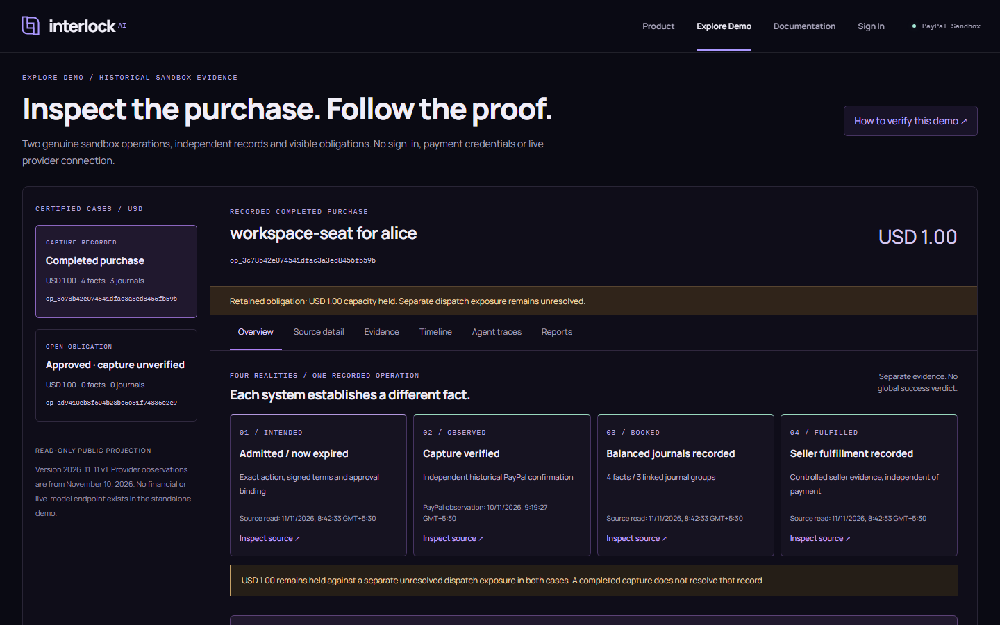
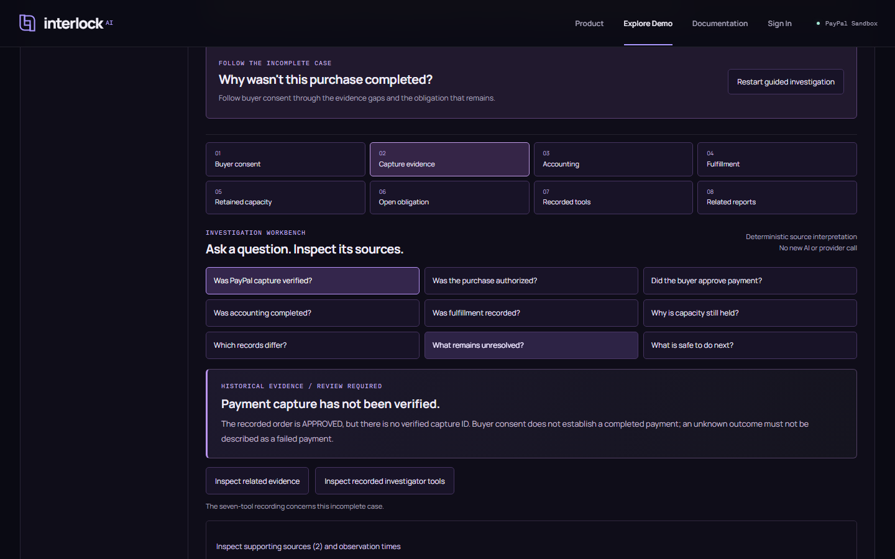

# Interlock AI

Interlock controls delegated AI purchasing: a model proposes a purchase,
deterministic policy checks the exact terms, an independent person approves,
and a credential-isolated broker executes a protected PayPal sandbox payment.
Its investigation workspace compares financial authority, provider observations,
accounting and seller evidence without allowing an AI conclusion to rewrite them.

**Python / PostgreSQL / PayPal Orders v2 / Next.js / React / official AG Studio 3.1.0**

[Run the credential-free demo](#reproduction) ? [Architecture](docs/architecture.md) ?
[Evidence and provenance](docs/provenance.md) ? [Screenshot gallery](docs/screenshots/README.md)



*Actual application. Historical USD 1.00 sandbox evidence; no current PayPal read.
A completed capture and a separate unresolved exposure are deliberately visible together.*

## Contents

- [The problem](#the-problem)
- [The shortest explanation](#the-shortest-explanation)
- [What works](#what-works)
- [A purchase that was approved but not verified as completed](#a-purchase-that-was-approved-but-not-verified-as-completed)
- [The genuine completed transaction](#the-genuine-completed-transaction)
- [AI agents](#ai-agents)
- [PayPal integration and financial invariants](#paypal-integration-and-financial-invariants)
- [Architecture](#architecture)
- [Official AG Studio](#official-ag-studio)
- [Reliability](#reliability)
- [Performance](#performance)
- [Reproduction](#reproduction)
- [Evaluation](#evaluation)
- [Repository structure](#repository-structure)
- [Originality](#originality)
- [Limitations and future work](#limitations-and-future-work)
- [Author and licensing](#author-and-licensing)

## The problem

A purchase recommendation leaves several questions unanswered. Who could spend?
Which seller, beneficiary, amount and currency were approved? Did the provider
actually capture payment? Did accounting record an economic effect? Did the
seller fulfill it?

Those questions require different evidence. Buyer consent can exist without a
verified capture. A completed reconciliation run can still leave an obligation
open. A lost response cannot safely be converted into either success or failure.
Interlock makes those differences inspectable and keeps financial authorization
outside the model.

## The shortest explanation

```mermaid
flowchart LR
  Intent[AI proposal] --> Terms[Signed seller terms]
  Terms --> Policy[Deterministic policy]
  Policy --> Approval[Independent exact-action approval]
  Approval --> Admission[Atomic USD reservation]
  Admission --> Broker[Protected broker]
  Broker --> Consent[PayPal order and buyer consent]
  Consent --> Capture[Separate capture authorization]
  Capture --> Verify[Canonical provider verification]
  Verify --> Facts[Authenticated facts and journals]
  Facts --> Seller[Controlled fulfillment]
  Verify --> Investigation[Read-only investigation]
  Facts --> Investigation
  Seller --> Investigation
```



The public explorer reads a versioned projection of previously authenticated
records. It cannot perform any step in the financial mutation path.

## What works

| Surface | Actual capabilities | Access / evidence classification |
| --- | --- | --- |
| Public explorer | Four Realities source drill-through, nine investigation questions, eight-step incomplete-case trail, comparison, timeline and JSON/HTML export | No login or private service; historical genuine sandbox records |
| Authenticated application | Scoped operations, signed terms, policy, independent approval, protected admission/checkout/capture and evidence | Separate local roles/services; current recorded grants are expired or revoked |
| Purchase planner | Native model-selected product, terms, authority and preparation-preview tools; validated reviewed draft | Configured local model; no financial authority |
| Investigator | Seven typed read-only evidence/report tools, grounded findings and bounded conclusions | Genuine earlier execution retained; public playback is recorded |
| Official AG Studio | Native filters/pages/layout/save-restore, normalized source relationships, custom Four Realities widget and Agent Framework report change | Separate local evaluation; public runtime/key excluded |

No hosted demo or public live payment service is claimed. The Node-only explorer
is independently reproducible; protected runtime requirements are separate.

## A purchase that was approved but not verified as completed

The signature investigation asks **Why wasn't this purchase completed?**

1. A recorded PayPal observation says **APPROVED**: the buyer consented.
2. No capture is verified. This is not described as a failed payment.
3. No payment journal or seller fulfillment is established.
4. USD 1.00 remains reserved, with zero free lifetime capacity.
5. Reconciliation retains an OPEN `MUTATION_OUTCOME_UNKNOWN` finding.
6. The operator can inspect the actual recorded tools and original source links,
   but the explorer cannot retry capture or release the hold.



The trail reuses deterministic source interpretations, rather than fabricating
AI answers. The genuine recorded investigation is available separately, with
its model, tool arguments, returned evidence and observation dates.

The original operation is `op_ad9410eb8f604b28bc6c31f74836e2e9`; order
`5NV48695TN707743S`. Its last published provider observation is November 10, 2026
at 04:24:06.307815 IST. Current PayPal state is not established.

## The genuine completed transaction

One protected USD 1.00 purchase of a workspace seat for `alice` completed the
recorded proposal, signed quote, SQL policy, independent human approval,
reservation, broker execution, genuine buyer consent, separately authorized
capture, independent provider verification, accounting, controlled fulfillment
and reconciliation path.

| Binding | Recorded evidence |
| --- | --- |
| Operation | `op_3c78b42e074541dfac3a3ed8456fb59b` |
| Order / capture | `4FM556283T043144X` / `6C4956371B715513Y` |
| Merchant / amount | `JB7TR6VHB4GTQ` / USD 1.00 |
| Accounting | Four economic facts; three balanced posting groups |
| Seller | Authenticated fulfillment fact |
| Reconciliation | Completed recorded run; no visible finding for this operation |
| Separate exposure | `EXPOSED_UNRESOLVED`; reserved capacity remains held |

The provider observation is from November 10 at 09:19:27.456135 IST. This is a
sandbox capture, not bank-settlement or production certification. The separate
legacy dispatch exposure was not silently closed.

The **later tool-using purchase planner did not generate this earlier payment**.
The original constrained proposal in the protected purchase and the later
planning/investigation demonstrations have separate provenance.

## AI agents

The purchase planner chooses typed native tools: `inspect_products`,
`inspect_commercial_terms`, `inspect_spending_authority`, `preview_purchase`,
and a validated finish operation. The deterministic preview and exact draft are
assembled from authenticated sources, not prices or destinations invented by
model text. A copied draft never grants spending authority.

The investigator chooses `inspect_authority`, `inspect_provider`,
`inspect_economic_facts`, `inspect_ledger`, `inspect_fulfillment`,
`reconcile_records`, and `select_studio_view`. Its conclusion must cite returned
finding IDs. Server-side validation rejects arbitrary tools, foreign operations,
extra arguments and ungrounded references.

Both workflows enforce bounded model turns, tool counts and time. They use a
configurable OpenAI-compatible endpoint; no personal model key is distributed.
The anonymous demo shows **genuine recorded executions**, never fresh inference.
[Tool contracts and permission boundaries](docs/agents.md).

## PayPal integration and financial invariants

PayPal Orders v2 is central to the implemented protected execution path:
CREATE an order, obtain genuine buyer consent, authorize CAPTURE separately,
then independently read canonical provider state before economic processing.
Browser return parameters are navigation hints, never settlement proof.

The existing kernel and focused/historical tests support these scoped properties:

- USD minor units remain explicit across terms, grants, reservations, operations
  and provider bindings; no implicit INR conversion.
- Approval is bound to the exact action/evidence/decision revision, with requester
  and approver separation.
- Admission checks budget conservation atomically under SQL guards.
- Provider phases use distinct persistent request identities committed before I/O.
- Duplicate commands do not authorize another logical capture.
- Current authority, merchant/order/amount/currency bindings and revocation checks
  are rechecked at protected send boundaries.
- Unknown or contradictory outcomes retain obligations pending trustworthy evidence.
- Financial facts and fulfillment require authenticated sources; model conclusions
  cannot post journals, release holds or rewrite provider observations.

These are implementation/test claims within the documented contracts, not
universal exactly-once external execution or a production security certification.

## Architecture

The system separates session authentication, deterministic authority, the
credential-isolated broker, economic processing, controlled seller, read-only
planning/investigation and public presentation. Non-login ownership roles and
runtime SQL roles are separate. The browser and model do not hold payment secrets.

[Service diagram, sequence and trust matrix](docs/architecture.md) ?
[Failure and recovery behavior](docs/reliability.md) ?
[Source projection and evidence integrity](docs/provenance.md)

## Official AG Studio

Official `ag-studio` and `ag-studio-react` **3.1.0** power the local reporting
surface. The integration uses normalized relationships across operation bindings,
provider observations, facts, journal lines and seller evidence. A custom widget
reads Studio's filtered data engine; native controls perform filtering, page
selection and layout editing/save-restore.

The genuine recorded seven-tool investigation applies its requested report page
through the official Agent Framework and Studio API. Playback changes an actual
report, not financial data, and does not invoke a model again.

The trial is evaluation-only. The public static build excludes its key and
commercial runtime. Local Studio recordings/screenshots without confirmed public
redistribution permission are withheld from this source release. This does not
prevent inspecting the original integration code or reproducing a legitimately
licensed local evaluation. [Sponsor and licensing details](docs/sponsors.md).

## Reliability

Current offline checks cover scoped native tool selection, unsupported objectives,
revocation during planning, changed grant revisions, time/tool budgets, malformed
responses, source identity mismatches, missing economic evidence and rate limits.
Public browser checks reject tampered evidence and keep unknown/conflicting states
separate from success. Historical SQL acceptance covers financial races and role
isolation; those results are identified as historical and synthetic-provider tests.

[Failure matrix with test references and gaps](docs/reliability.md).

## Performance

A bounded earlier local benchmark on Windows 11 measured five fresh browser
contexts at 384-458 ms to the workbench. Twenty case selections measured
p50/empirical p95 49.8/53.6 ms; twenty fact filters measured 17.9/21.5 ms.
A separate 45-request authenticated GET workload returned 16/16 successes at
concurrency four and bounded HTTP 429 refusals under overload.

These measurements precede the final UI refinement. They use a tiny dataset,
loopback, warm OS/server caches and small samples. They do not establish Internet
latency, production throughput, p99 or horizontal scalability.
[Raw measurements and methodology](docs/performance.md).

## Reproduction

For the independent public explorer, use Node.js 22+ and the locked dependencies:

```sh
cd web
npm ci
npm run demo:build
npm run demo:serve
```

Open **http://127.0.0.1:3020/demo/**. No environment file, database, PayPal account,
model subscription, saved session or Studio key is needed. Output: `dist/judge`.
The builder assembles an explicit static route allowlist and excludes financial
APIs, private authentication and live inference.

[Public installation and separate protected-stack requirements](docs/reproduction.md).
Never run financial tests against an existing project database.

## Evaluation

```sh
node --test tools/release/evidence.test.cjs tools/release/investigation.test.cjs
cd web
npm run typecheck
npm run lint
npx playwright install chromium
npx playwright test --config playwright.refinement.config.ts
```

Python's focused offline suites require Python 3.12+ and locked dependencies:
`python -m pytest hackathon_tests/test_commerce.py hackathon_tests/test_investigator.py -q`
with `PYTHONPATH=backend`. They use synthetic model/provider fixtures, not new
payments. GitHub Actions is not configured in this public release, by the
owner's explicit decision after a workflow-scope authorization rejection. The
documented checks run locally without financial credentials. No CI success is
claimed. See [publication and dependency audit](docs/publication/README.md).

The preceding engineering checkpoint passed 82 Python tests, 33 Node tests and
42 unique browser checks. Final-refinement results are recorded separately in
[the release evaluation](docs/evaluation.md). Historical Pass 7's 707-case result
is retained as historical evidence; it was not rerun in these frontend releases.

## Repository structure

```text
backend/interlock/       authority, PayPal runtime, economic and agent services
migrations/             frozen reference financial foundation
paypal_migrations/      additive versioned USD/PayPal contracts
paypal_acceptance/      guarded SQL/adversarial acceptance cases
hackathon_tests/        isolated offline PayPal/AI tests
web/app/judge/          public source-backed investigation experience
web/app/paypal/         protected workspace and official Studio integration
tools/release/          deterministic projection/build/review tools
docs/                   architecture, evaluation, provenance and screenshots
third_party/            dependency inventories and preserved notices
```

## Originality

Interlock builds on a preexisting Pass 7 financial foundation, frozen at
`bf6f98dfd614061f1c5937dfc206fd5f2ee84cf8`. Hackathon work adds protected PayPal
sandbox execution, constrained/tool-selecting AI workflows, real provider and
seller evidence, official Studio integration, investigation/reporting and an
independent public product. It is not described as an entirely new codebase.

This public repository is a **reviewed source snapshot**, not the original private
Git history. Original history/tags/evidence are preserved separately. Private
profiles, operational dumps and unapproved evaluation media are withheld, with
source and omission manifests. [Development and release provenance](docs/provenance.md).

## Limitations and future work

One controlled merchant/product/beneficiary and USD sandbox scope are demonstrated.
Current grants are expired/revoked; no new payment is offered by the public demo.
Historical observations are not current provider state. Unresolved obligations
remain visible. Private financial bootstrap requires independently reviewed
isolation/roles; it is not a one-command portable clone. Public inference and
public Studio hosting await appropriate usage/licensing arrangements.

Independent human usability studies, broader customer validation, production
security review and distributed performance validation remain future work.
Render hosting, YouTube publication and Devpost submission are separate stages;
none is claimed merely because this source is available. APIMatic returned 401,
so successful APIMatic integration is not claimed.

## Author and licensing

Built by [Adithya Sanjeevi](https://github.com/ADITHYA-SANJEEVI).
Original project code is [MIT licensed](LICENSE), based on the owner's recorded
release permission. Commercial SDKs, fonts and other dependencies retain their
own rights: [third-party notices](THIRD_PARTY_NOTICES.md). No provider credentials,
private databases, personal model subscription or evaluation key is included.
