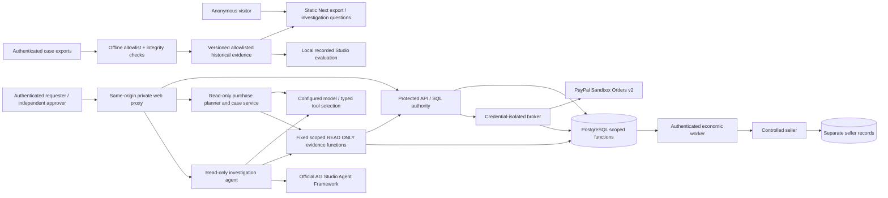

# Architecture and permission matrix

This describes inspected code, not a new deployment. Financial behavior is
unchanged from the certified baseline. The separate public application needs
none of the private services below.

Arrows into the broker/economic/seller path describe existing protected
capabilities, **not actions executed in Directive 020**. A model's native tool
call is validated server-side; it is not an arbitrary request to these services.
Reconciliation compares independent records and does not confer payment powers.

| Surface / source | Effective permission | Dependencies / prohibited authority |
| --- | --- | --- |
| `tools/release/build-demo.cjs`, `web/app/judge/*` | Build-time allowlist; anonymous static GET; deterministic presentation | Sanitized two-case bundle only. No session, financial route, model or database. Default export excludes Studio/key. |
| `web/app/api/[...path]/route.ts`, `api/paypal`, `api/commerce`, `api/investigations` | Same-origin proxy with session/CSRF/body/path restrictions | Browser never receives broker credentials or arbitrary upstream destinations. UI role hints do not authorize commands. |
| `backend/interlock/paypal_services.py`, `paypal_contracts.py` | Requester prepares/admit; independent approver approves exact terms; issuer/current authority protects capture | Closed DTOs, explicit USD, canonical action/revision/approval bindings; no browser-selected merchant/price/capture identity. |
| `paypal_kernel.py`, `paypal_migrations/sql/*` | Runtime `interlock_api` calls narrowly granted functions; owners remain separate | Atomic reservation, conservation, lock ordering, revocation/freshness, exact persistent request identities. No direct public table writes. |
| `paypal_flow.py`, `paypal_runtime.py`, `paypal_sandbox.py` | Separate broker runtime and PayPal sandbox credential profile | Broker-only provider effects; CREATE and CAPTURE are independently guarded. Canonical observations are separate from redirects. |
| `paypal_economic.py`, `paypal_reconciliation.py` | `interlock_economic` authenticated receipt processing; protected reconciliation | Facts/postings and seller fulfillment are separate; unknown obligations retained. No inference-generated economic facts. |
| `purchase_planner.py`, `commerce_api.py` | Authenticated `PURCHASE_REQUESTER`; model chooses typed commercial/authority/preview tools | Fixed `workspace-seat`, USD, verified merchant and user beneficiary/limit. 6 turns, 10 tool executions, 90s budget; no financial command client. |
| `investigator.py`, `investigation_api.py`, `investigation_reads.py` | Scoped identity + operation; native typed evidence tools; bounded report-page request | 6 turns, 12 tools, 90s budget. No model-selected SQL, URL, merchant or mutation tool. `interlock_api` session user; READ ONLY transactions and 5s SQL statement timeout. |
| `web/app/paypal/studio-analyst.ts`, `EvidenceStudio.tsx` | Genuine live investigator response → allowlisted official report changes | Report state is presentation, never financial evidence. Original harness unchanged. |
| `web/app/judge/RecordedStudio.tsx` | Local evaluation: historical data, native filters/layout/page APIs, recorded SDK replay | Replays genuine prior choices; no fresh model/tool/backend call. Separate from private live investigator and public no-key fallback. |

The planner and investigator use a common configurable native-tool model
transport (`InvestigatorModel`), but **different toolsets**. Tests prove alternate
tool order, feedback between turns, invalid tools/arguments/scope rejection and
bounded schema repair. Their typed final conclusions cannot override source
records. Prompt instructions supplement those runtime checks; they are not the
financial security boundary.

## Narrow maintenance decisions

The oversized financial `Workspace.tsx` remains a maintenance risk. It is not
rewritten under a deadline: 47 existing event/disabled guards and authority
handlers remain structurally identical. The new workbench instead has a pure
`investigation.ts` interpretation contract and a separate presentation component.
It reuses the existing Sources/TraceView/Studio integration, not another backend.
Source citations point into the immutable bundle and expose unavailable fields
without inventing timestamps or approval visibility. Existing report export
sources and the original live Studio harness remain unchanged.

The local role-isolated private runtime is not a turnkey public multi-tenant
deployment. Process-local concurrency/rate limits are bounded single-instance
controls, not distributed quotas. PostgreSQL SQL locks/constraints protect
financial invariants; no horizontal scalability result is inferred from that
architecture or from a loopback benchmark.

The Node-only static clean checkout is the independent judge reproduction path.
Additional protected-runtime prerequisites remain in the reproduction guide.

## Protected purchase sequence

~~~mermaid
sequenceDiagram
  participant R as Requester
  participant A as AI proposer
  participant S as Controlled seller
  participant K as SQL authority
  participant H as Independent approver
  participant B as Protected broker
  participant P as PayPal Sandbox
  participant E as Economic worker
  R->>A: Bounded intent
  A-->>R: Non-authoritative proposal
  R->>S: Resolve signed USD terms
  S-->>K: Exact quote, merchant and expiry
  R->>K: Deterministic policy evaluation
  H->>K: Independent exact-action approval
  R->>K: Admit and atomically reserve
  K-->>B: Bound operation authority
  B->>P: CREATE with persistent identity
  P-->>R: Consent URL
  R->>P: Genuine buyer consent
  R->>K: Separate capture authorization
  B->>P: Canonical read, guarded CAPTURE
  B->>P: Independent canonical verification
  B-->>E: Authenticated receipt
  E->>K: Facts and balanced journals
  E->>S: Guarded fulfillment
~~~

This describes existing protected capabilities, not actions invoked by the
public explorer. Unknown results retain their original operation/obligation;
neither redirects nor model conclusions establish settlement.

| Reality | Independent source | Completed recorded case | Incomplete recorded case |
| --- | --- | --- | --- |
| Intended | Exact action/policy/approval/reservation | Admitted; authority now expired | Admitted; authority now expired |
| Observed | Canonical PayPal observation | Completed capture verified | APPROVED; capture unverified |
| Booked | Authenticated facts / linked journals | Four facts / three balanced groups | No facts/journals established |
| Fulfilled | Controlled seller | Fulfillment recorded | Not established |
| Obligation | Dispatch exposure / stored finding | Separate exposure unresolved | Retained capacity and OPEN UNKNOWN |

Four Realities cards open corresponding interpretations and original source
fields. The guided trail reuses the same question contract. URL/report state
carries presentation context, never spending authority.
