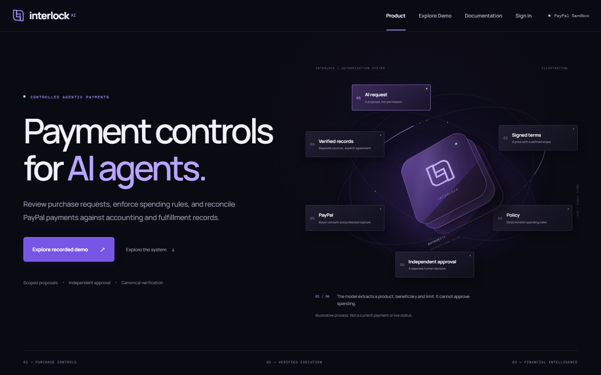
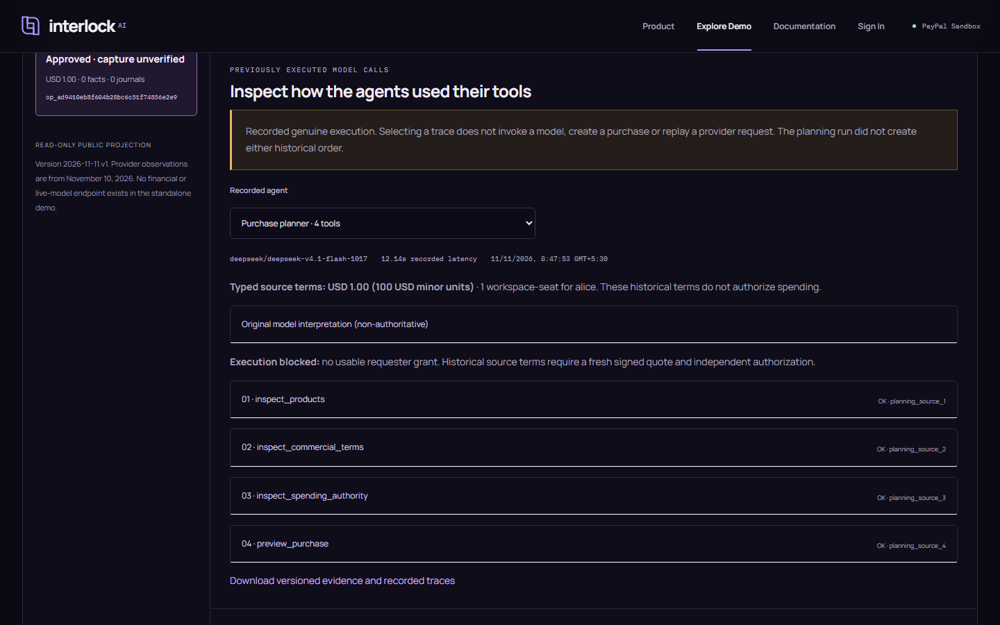
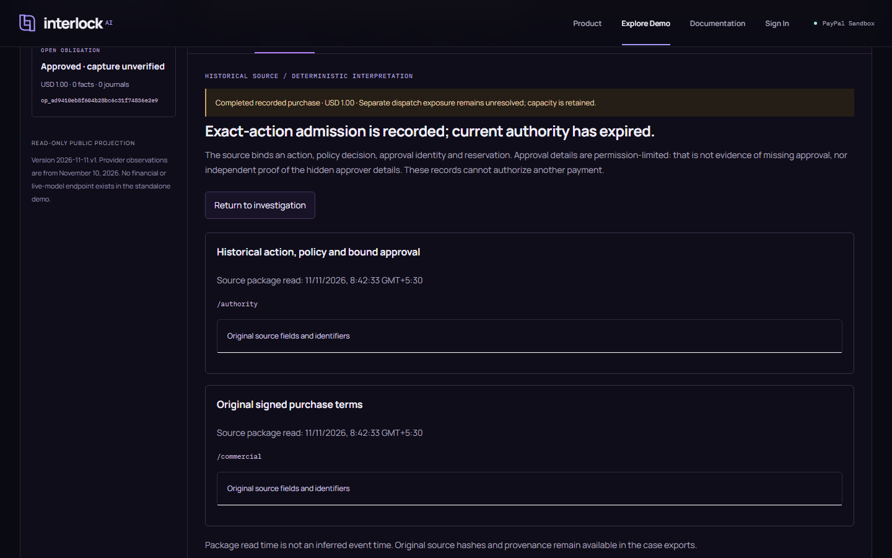
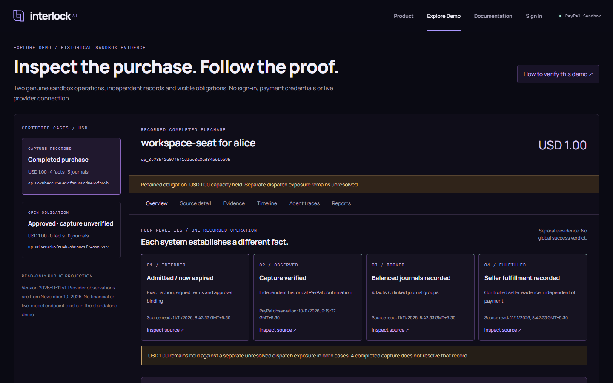
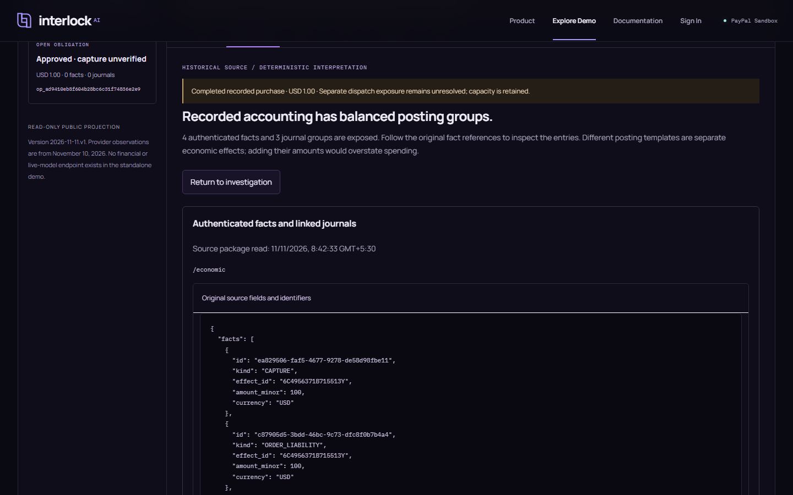
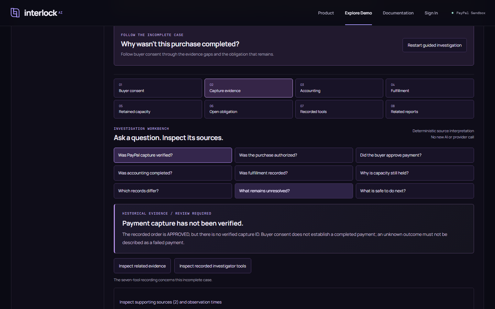
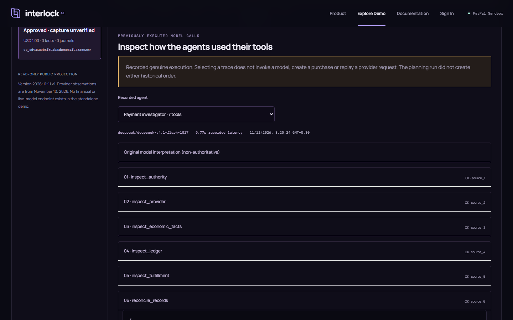
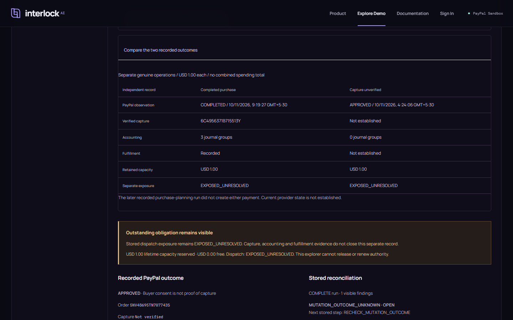

# Actual application gallery

All images are genuine 1440x900 headless browser captures of the standalone
public app. Financial observations and model traces are historical; none is
presented as a new payment or fresh inference. Images contain no browser chrome,
credentials or licensed Studio runtime. No sponsor promotional artwork is copied.

## Product introduction

## Recorded genuine purchase planner

The later planning run did not create the earlier completed purchase.

## Historical financial authority

## Completed purchase across Four Realities

## Original accounting source

## Guided incomplete-case investigation

## Genuine recorded investigation

## Compare the distinct outcomes

Official Studio is implemented and exercised locally. Its trial media are
withheld pending redistribution permission; no substitute image is fabricated.
See [licensing and sponsor scope](../sponsors.md). The screenshot manifest records
actual capture hashes and provenance.
